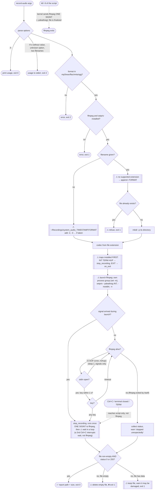
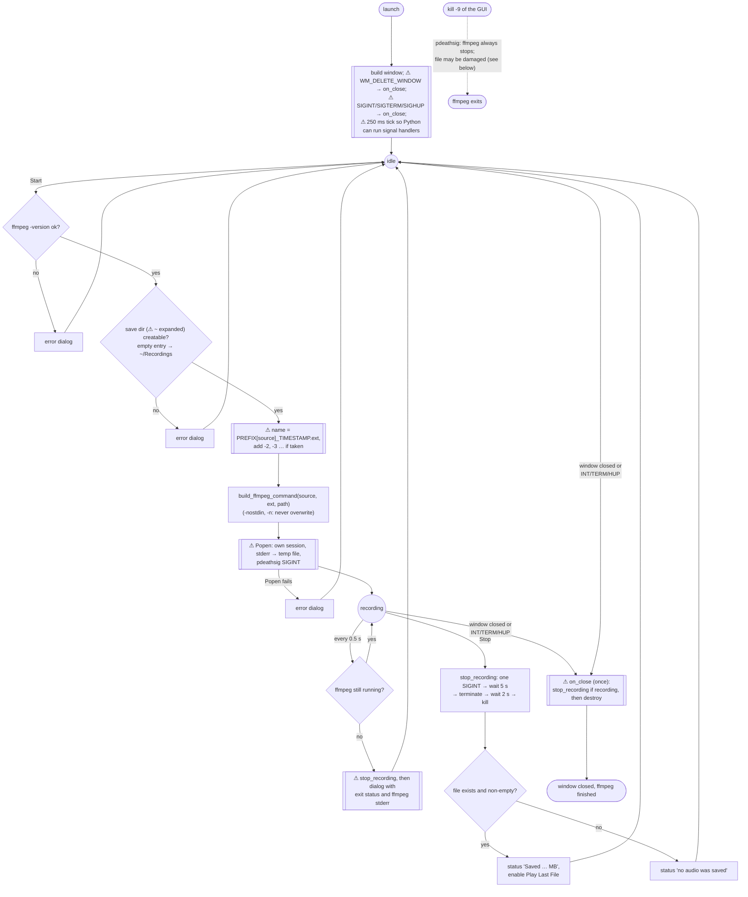

# Program flow

How each entry point moves from launch to a saved file, and which test pins each branch. Shapes carry meaning, not color: rounded = start/end, diamond = decision, double-bordered = behaviour added after an audit, marked ⚠ in its label.

## Terminal recorder (`record_audio.sh`)

**Why the process group matters.** A terminal delivers Ctrl+C to every process in its foreground process group. Originally ffmpeg shared the script's group, so it got the terminal's SIGINT and then a second one from the script's trap. ffmpeg treats a repeated SIGINT as "immediate exit" and abandons the file: the result was a 0-byte recording while the script printed "Recording complete!". Now ffmpeg sits in its own group and gets exactly one SIGINT however the script is stopped.

`set -m` is used rather than `setsid`, because `setsid` forks when its caller is already a process-group leader (whenever the launching shell has job control on). `$!` would then name a process that exits at once while ffmpeg keeps running detached.

**Why `--pdeathsig`.** A trap can't catch `kill -9`. Without it ffmpeg, being in its own group, would keep recording until the disk filled. `setpriv --pdeathsig INT` has the kernel send ffmpeg one SIGINT when the script dies, and ffmpeg finalizes the file. bash is single-threaded, so the signal is sent exactly once (tested).

**Why the wait loop.** A second Ctrl+C during the stop interrupts the script's `wait` (it returns 130) while ffmpeg is still writing. Earlier the script took 130 as ffmpeg's status and reported failure for a good file. It now waits until ffmpeg is gone, then reads ffmpeg's own status. A plain single `wait` also failed occasionally on ordinary stops; the loop fixed that too (found by mutation testing).

## GUI (`audio_recorder_gui.py`)

Originally, closing the window while recording destroyed the GUI but left ffmpeg recording in the background with nothing on screen to show it. Killing the GUI by signal (logout, `kill`, Ctrl+C in the launching terminal) did the same.

**Known limitation: `kill -9` of the GUI.** ffmpeg always stops, but in about 1 run in 5 the file isn't finalized. The kernel's parent-death signal is tied to the parent *thread*, and Tk runs more than one thread. When the GUI is killed, ffmpeg can be handed from one dying thread to the next and receive SIGINT once per handoff (seen in `strace`: two SIGINTs from the dying GUI's pid). A second SIGINT makes ffmpeg abandon the file. Closing the window and SIGINT/SIGTERM/SIGHUP don't have this problem; they go through `on_close`. A single-threaded helper process between the GUI and ffmpeg would remove the limitation.

## Test coverage map

| Branch | Test |
|---|---|
| CLI: Enter stop, all five formats | `test_cli.sh` §1 |
| CLI: Ctrl+C to the whole process group → valid file, no stray ffmpeg | `test_cli.sh` §2 `ctrlc` |
| CLI: double Ctrl+C 50 ms apart → exit 0, valid file | `test_cli.sh` §2 `double-ctrlc` |
| CLI: terminal closed (SIGHUP) → valid file, no stray ffmpeg | `test_cli.sh` §2 `hup` |
| CLI: `kill -9` of the script → ffmpeg finalizes the file and exits | `test_cli.sh` §2 `kill9` |
| CLI: stdin at EOF → no busy loop, SIGTERM stops cleanly | `test_cli.sh` §2 `eof-term` |
| CLI: ffmpeg killed mid-recording → exit 1 + "unexpectedly" | `test_cli.sh` §3 |
| CLI: existing file not overwritten; missing extension gets `-f` format | `test_cli.sh` §4 |
| CLI: bad format, missing value, unknown option, two filenames → exit 2; `--help` → 0 | `test_cli.sh` §5 |
| GUI: command per source, codec per extension, `-n`, `-nostdin` | `BuildCommandTests` |
| GUI: unique filenames | `UniquePathTests` |
| GUI: start/stop writes a valid file, all five formats | `test_start_stop_writes_valid_file` |
| GUI: closing the window stops ffmpeg and keeps the file | `test_closing_window_stops_ffmpeg` |
| GUI: ffmpeg dying is reported to the user | `test_ffmpeg_dying_is_reported` |
| GUI: microphone files are named for their source | `test_mic_file_is_named_for_its_source` |
| GUI: SIGTERM / SIGHUP / SIGINT to the GUI → valid file, ffmpeg stops | `GuiDeathTests` |
| GUI: SIGKILL to the GUI → ffmpeg stops (file not checked, see limitation) | `GuiDeathTests.test_sigkill` |
| Installer: install, re-run, uninstall; user files never replaced; symlinked checkout; quoted `Exec` | `test_install.sh` |

Each regression test was checked by mutation: remove the fix, confirm the test fails.

Not covered by automated tests: a signal landing in the microseconds between ffmpeg's launch and `$!` being recorded (the code handles it; there's no reliable way to aim a signal there); the GUI's 5 s SIGINT timeout → terminate → kill escalation; the save-directory and Popen-failure error dialogs; *Open Save Directory* / *Play Last File* (they hand off to `xdg-open`). The GUI freezes for up to 7 s while that escalation runs, which is accepted for a stop that normally takes well under a second.
